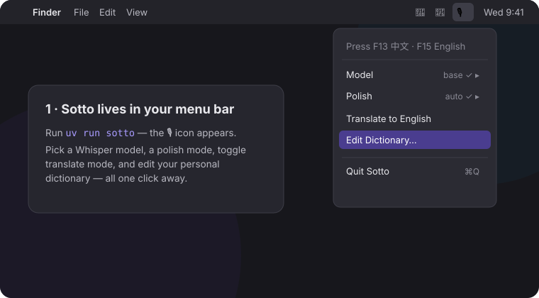
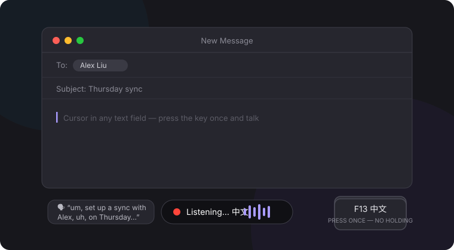
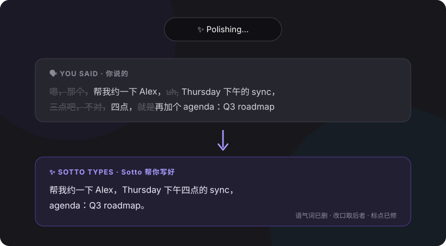
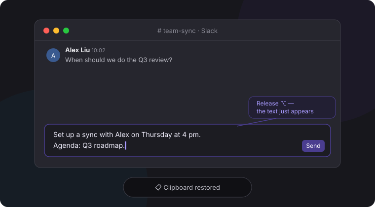

# Sotto

[](https://github.com/chloe4ai/sotto/actions/workflows/ci.yml)

**A dictation tool that is always listening has already made the expensive trade.**

*Sotto voce* — in a soft voice. Sotto is for people who write in two languages all day and would rather talk than type: press a key, speak, press it again. Audio is transcribed on your own machine with [faster-whisper](https://github.com/SYSTRAN/faster-whisper), cleaned up, and pasted where the cursor already is. **F13 for 中文, F15 for English.**

▶ **[Download for macOS or Windows](https://github.com/chloe4ai/sotto/releases/latest)** — `.dmg` for Apple Silicon, portable `.exe` for Windows 10/11.

---

## The product argument

**1. An explicit key press, not an open microphone — because the two failure modes cost different amounts.**
Always-listening buys about one second of convenience. It costs a live mic and a class of failure that writes text into whatever window you happen to be in. Sotto's audio stream opens on a press and closes on a press, and the edges are handled rather than assumed: takes under `min_duration` (0.3 s) are discarded as accidental taps, and a forgotten stop is capped at `max_duration` (300 s) and transcribed rather than buffered forever. Modifier keys are rejected outright as dictation keys — a stray ⌥ while typing would silently start recording, the exact bug this design exists to avoid.

It is press-to-toggle rather than hold-to-talk because holding a key through a two-minute thought is a physical tax, and because macOS repeats key-down events while a key is held.

**2. One key per language beats a language picker, because a picker is a step you take before you know you need it.**
Whisper can auto-detect, but detection drifts mid-sentence — the dominant failure when you switch languages often rather than occasionally. Sotto hands the model the language up front, keyed to the hotkey you hit: `{"f13": "zh", "f15": "en"}`. Pressing the *other* key while recording ends the take instead of switching mid-sentence. `"auto"` is available per key if you want it.

**3. Polish is a spectrum with a network boundary in the middle, so it is a mode, not a checkbox.**

| Mode | What runs | Leaves the machine |
|---|---|---|
| `off` | Raw Whisper output | No |
| `local` | Regex cleanup — a narrow filler list (`um/uh/erm/hmm`, `嗯/呃/唔`), repeated-word collapse, spacing, punctuation | No |
| `ai` | Claude (`claude-haiku-4-5`) applies mid-sentence self-corrections, formats dictated lists, fixes tone | Yes |
| `auto` | `ai` if `ANTHROPIC_API_KEY` is set, else `local` | Only if you set a key |

The local tier removes only tokens that are essentially never meaningful, so it cannot change what you said; the AI tier can do more, and is therefore opt-in. If the API call throws, it falls back to `local_polish` rather than erroring — a dictation tool that loses your words once does not get used twice.

**4. The personal dictionary is worth hand-maintaining, because transcription error is not uniformly distributed.**
Whisper is fine on common words and unreliable on exactly the words carrying the meaning: names, product names, jargon. `~/.sotto/dictionary.txt` attacks that from both sides — a bare term (`Kubernetes`) goes to Whisper as its `initial_prompt` (first 40 entries), biasing recognition *before* the mistake; a rule (`cloudy tan -> Chloe Tan`) rewrites the output *after* it. Twenty lines you maintain once beat a larger model on your own vocabulary.

---

## How it works

```
press F13 ──▶ record ──▶ press F13 ──▶ Whisper (local) ──▶ polish ──▶ ⌘V insert
```

The menu bar carries model size (`tiny`…`large-v3`), polish mode, translate and the dictionary; a capsule shows which language is recording; the previous clipboard is restored 0.6 s after the paste. *Translate to English* uses Whisper's own translation task — offline, and only *into* English.

 
 

## Install

**macOS (Apple Silicon):** open the `.dmg` and drag Sotto to Applications. It is not notarized (no paid developer certificate behind this project), so macOS blocks the first launch:

1. Open Sotto from Applications. When macOS says it can't be opened, click **Done** (not *Move to Trash*).
2. Open System Settings › Privacy & Security, scroll down to **Security**, and click **Open Anyway** next to the message about Sotto.
3. In the dialog that follows, click **Open Anyway** again and confirm with your password or Touch ID. This is only needed once.

On macOS 15 Sequoia and later, *right-click → Open* no longer gets past this check; on macOS 14 and earlier it still works. If no **Open Anyway** button appears, remove the download quarantine flag in Terminal instead:

```bash
xattr -dr com.apple.quarantine /Applications/Sotto.app
```

Then grant **Microphone** and **Accessibility** in System Settings › Privacy & Security, and quit and reopen once; macOS only applies a grant to newly started processes. That is the whole permission surface — no screen recording, no camera, no cloud.

**Windows 10/11 (beta):** run `Sotto.exe` — portable, nothing to install. SmartScreen → *More info → Run anyway*; first start unpacks for ~20–30 s.

**From source** — needs [uv](https://docs.astral.sh/uv/); Python 3.11–3.14 is fetched for you:

```bash
git clone https://github.com/chloe4ai/sotto.git && cd sotto
uv sync                 # add --extra ai for Claude polishing
uv run sotto
uv run sotto --doctor   # checks permissions and setup
```

First run downloads the Whisper `base` model (~150 MB, once); offline afterwards. `~/.sotto/config.json` holds hotkeys, model, polish mode, task and durations — any [pynput key name](https://pynput.readthedocs.io/en/latest/keyboard.html) plus a Whisper language code.

**Nothing happens on a key press:** almost always Accessibility (plus Input Monitoring on some macOS versions); run `--doctor`. macOS silently revokes the grant when your terminal updates — toggle it off and on. **Mic blocked:** the permission belongs to the app you launched from, and if you once clicked *Don't Allow*, macOS never asks again (`tccutil reset Microphone <bundle-id>`). **F13–F20** don't exist on laptop keyboards — pick other keys or remap with [Karabiner-Elements](https://karabiner-elements.pqrs.org/).

## What this is not

- **No accuracy number.** There is no WER harness against a held-out set of my own speech, so every claim here is about the design, not the recognition quality.
- **The dictionary biases, it does not guarantee.** `initial_prompt` is a hint, and only the first 40 terms are sent.
- **One language per take** — deliberately, per decision 2, but code-switched sentences do come out worse than either language alone.
- **Unsigned on both platforms.** Read the code or build from source if that matters.

## What I'd build next

- **A WER harness** over a fixed set of my own recordings, per model size and per language, so "switch to `small`" becomes a number and the dictionary's contribution is measured rather than assumed.
- **Speak-to-edit**: select text, speak an instruction. Measure how often the edit is accepted unmodified — an edit you fix by hand is slower than typing.
- **Hotkeys settable from the menu bar**, so the commonest setup failure stops requiring a JSON file.

## License

MIT
